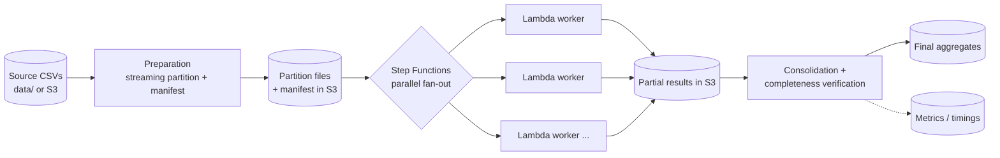

# Architecture

Current architectural understanding for the parallel CNPJ "Estabelecimentos" processing pipeline and its performance experiment. Every element is tagged:

- **[Confirmed]** — agreed with the project owner or established by existing implementation.
- **[Proposed]** — plausible option under consideration; not yet approved or validated.
- **[Open]** — requires clarification, investigation, or a future decision.

Companion context: `../AGENTS.md` (working rules) and `docs/project-overview.md` (goals, requirements, environment).

## High-level data-processing flow

[Proposed] Logical pipeline. Concrete component boundaries and contracts are not yet designed; this diagram only fixes the overall shape.

## Components and responsibilities

| Component | Responsibility | Status |
|---|---|---|
| Source data store | The 10 decompressed Estabelecimentos CSVs (~16.2 GB total). Locally under `data/` (gitignored); on AWS, uploaded to S3. | [Confirmed] |
| Preparation stage | Stream the CSVs, split into independently processable partitions without breaking quoted rows, and write a manifest describing every processing unit (paths, byte ranges or record counts, checksums). | [Proposed] |
| Manifest | The single source of truth for coverage: every input record must belong to exactly one unit; consolidation verifies all units completed. | [Proposed] |
| Orchestration | Step Functions state machine: prepare → fan out workers (bounded by configurable concurrency) → consolidate → report. | [Confirmed] |
| Workers | Node.js/TypeScript Lambda functions; each processes one unit and writes one partial result. | [Confirmed] |
| Storage layout (S3) | Separate prefixes for source, prepared partitions, partial results, final output. Bucket/prefix names not yet fixed. | [Proposed] |
| Consolidation | Merge partial aggregates and cross-check counts against the manifest (e.g., input records seen vs produced). | [Proposed] |
| Measurement harness | Controls experiment configuration, runs repetitions, collects timings and throughput, emits metrics. | [Proposed] |
| Infrastructure as code | AWS CDK is preferred where emulator compatibility allows it; not yet mandated. | [Proposed] |

## Large-input handling

- **Streaming is mandatory** (30 GB RAM vs ~16 GB dataset): both preparation and workers must read bounded windows of data, never whole files. [Confirmed]
- **CSV structure implications** [Confirmed from sample]: semicolon delimiter, all fields quoted, quoted fields may contain delimiters (and potentially line breaks in the full data), **no header row**. Any partitioner must therefore split on record boundaries (newline inside unclosed quote handling), not on raw line counts. Splitting by byte ranges requires resynchronization at the next valid record boundary.
- **Partition sizing** [Open]: units should be sized for Lambda constraints (invocation duration, payload limits) and for good load balance; size range to be determined experimentally (ties into the input-size independent variable).
- **Anomaly**: archive 0 decompresses to 7.26 GB vs ~1.1 GB for the others. [Open] — investigate before finalizing partitioning.

## Parallel execution

- **Configurable concurrency** [Confirmed] is the core independent variable. Candidate knobs, to be validated against Floci:
  - Step Functions Map `MaxConcurrency` (inline Map ceiling 40, Distributed Map ceiling 10,000 per AWS; Floci implements both).
  - Lambda reserved concurrency and Floci's per-region concurrent-execution limit (default 1000, configurable).
  - Distributed Map `ItemBatcher` (batch size / bytes per child execution).
- **Distributed Map over S3** [Proposed]: Floci's Map `ItemReader` reads CSV directly from S3 with `SEMICOLON` delimiter and quoted-field support — a natural fit, but its exact semantic match to this dataset (no header row, `CSVHeaders: GIVEN` requirement, MaxItems ceiling of 100,000,000) must be validated. Alternative: explicit per-partition task fan-out driven by the manifest.
- **Saturation study** [Confirmed goal]: sweep concurrency from 1 upward (and vary input size) until wall time stops improving or degrades; measure per-run overhead sources (cold starts, container scheduling, I/O contention, orchestration latency).

## Result consolidation and completeness

- Workers are pure functions of their input unit; partial results are written to S3 and consolidated by a final stage. [Proposed]
- **Completeness verification** [Confirmed requirement]: every unit in the manifest must have a corresponding, checksummed partial result; aggregate output must account for all input records (tolerance for malformed rows must be defined — [Open]).
- **Failure handling**: Step Functions `Retry`/`Catch` with task tokens or per-unit retries; Lambda async-invocation retries/DLQ exist in Floci; idempotency of consolidation (re-runs must not double-count). [Proposed]
- Malformed-record policy (skip-and-count vs fail-the-unit) is [Open] pending inspection of the full dataset.

## Local emulation (Floci) vs real AWS

**Floci is the only supported emulator** [Confirmed — user decision; LocalStack excluded]. Verified facts about Floci (from its documentation, Sept–Oct 2026):

- MIT-licensed, Docker-based, 126 services on `:4566`; works with AWS SDK v3 via `AWS_ENDPOINT_URL`; compatibility-tested against SDKs, CLI, and CDK.
- **Lambda** runs function code in real Docker containers using AWS runtime images (execution model close to AWS): warm pools, reserved concurrency, async retries/destinations/DLQ, event source mappings. Not implemented: provisioned concurrency, `InvokeWithResponseStream`, layer permissions. Defaults: 128 MB memory, 3 s timeout, per-region concurrency limit 1000 (all configurable).
- **S3** and **Step Functions** are emulated in-process (not the real engines). Documented Step Functions deviations include: `Wait` capped at 30 s locally, `ActivityStarted` emitted at schedule time, closed execution names never released, Express execution history retained indefinitely (unbounded store growth in tight loops).
- Storage modes (`memory`/`persistent`/`hybrid`/`wal`) control durability across restarts; persisted state default path `./data` must be redirected (e.g., `floci-data/`) to avoid colliding with the dataset directory.
- **Fidelity limits to respect** [Confirmed expectations]:
  - Emulator timings ≠ AWS timings (startup, cold starts, network, orchestration latency). Local and AWS runs are separate measurement regimes; local results are for development and behavior validation, not for absolute performance claims.
  - Service-side quotas differ (Floci's configurable per-region limit vs AWS account quotas). Concurrency sweeps must record which limit governed each run.
  - Any Step Functions feature used must be checked against Floci's documented deviations before relying on it in experiments.

**Coupling rule** [Confirmed]: application code uses AWS SDK v3 + standard endpoint configuration only; Floci-specific configuration is confined to the operational/experiment layer. Pin the Floci image to a fixed version tag for reproducibility.

**Real AWS** [Confirmed planned]: account exists; credentials setup deferred. The same IaC and code must deploy unmodified; timing comparisons are qualitative (e.g., saturation point, scaling shape), not absolute values.

## Observability

- [Proposed] CloudWatch Logs from workers (emulated locally by Floci), Step Functions execution history (rich event data, including per-branch timing), and S3-level accounting (object counts, sizes).
- [Proposed] Explicit timing instrumentation in the harness: prep time, fan-out time, per-worker durations, consolidation time, total wall time — plus throughput (records/s) and per-run configuration metadata.
- [Open] Whether to use CloudWatch Metrics vs plain files for experiment data.

## Performance measurement approach

- Baseline `T(1)` with concurrency 1; then increasing concurrency levels (set to be defined) and, separately, increasing input sizes.
- Per configuration: N repeated runs (assignment requires repetition; count to be defined), reporting mean/median wall time and throughput.
- Derived metrics: speedup `S(p) = T(1)/T(p)`, parallel efficiency `S(p)/p`.
- Saturation: identify the knee/ceiling, and attribute it (I/O, CPU contention, emulator orchestration, Lambda scheduling, consolidation serialization).
- Local experiments use controlled subsets (one or a few archives); one full 10-archive end-to-end run validates scale and completeness. [Confirmed]

## Technical risks and alternatives

| Risk | Notes |
|---|---|
| Emulator fidelity | S3/SFN in-process engines; timing artifacts; quota differences. Mitigation: validate feature set against Floci docs; keep measurements emulator-aware. |
| Dataset scale on one machine | 16 GB data on 282 GB disk is fine; 30 GB RAM forces streaming. Full local runs may take long; subsets are the experiment workhorse. |
| Unknown malformed records | Sample proves nothing about the full data; need a validation pass and an explicit malformed-record policy before finalizing correctness claims. |
| Step Functions Map limits | AWS inline/Distributed concurrency ceilings and Floci's implementation details must be checked before choosing the fan-out mechanism. |
| AWS cost/time of full run | One full run on AWS is planned; budget and time must be validated with the owner before execution. |
| Consolidation bottleneck | Final merge is serial by nature; must be instrumented so it doesn't silently dominate results. |
| Alternatives considered and not selected | SQS fan-out, local non-AWS Node baseline, LocalStack. [Confirmed] |

## Open architectural questions

1. Exact aggregation dimensions and output format (also listed in `docs/project-overview.md`).
2. Fan-out mechanism: Step Functions Distributed Map `ItemReader` (S3 CSV) vs manifest-driven per-partition tasks — needs validation against Floci and AWS semantics.
3. Partitioning strategy and unit sizes (byte-range + resync vs record-count splits).
4. Malformed-record handling policy.
5. Experiment parameter sets: concurrency levels, input sizes, repetition counts.
6. Whether AWS CDK is used or an alternative IaC approach is preferred after Floci compatibility validation.
7. Estabelecimentos0 size anomaly — inspect during preparation.
8. Official RFB field-name layout cross-check (gov.br unreachable during initial exploration).
