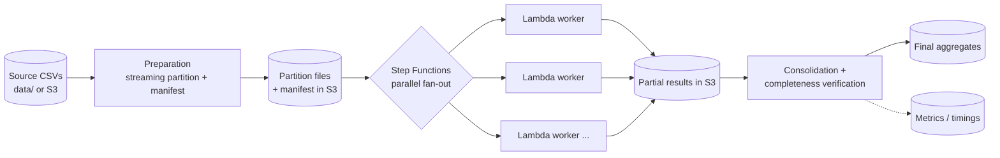

# Architecture

Current architectural understanding for the parallel CNPJ "Estabelecimentos" processing pipeline and its performance experiment. Every element is tagged:

- **[Confirmed]** — agreed with the project owner or established by existing implementation.
- **[Proposed]** — plausible option under consideration; not yet approved or validated.
- **[Open]** — requires clarification, investigation, or a future decision.

Companion context: `../AGENTS.md` (working rules) and `docs/project-overview.md` (goals, requirements, environment).

## High-level data-processing flow

[Proposed] Logical pipeline. Concrete component boundaries and contracts are not yet designed; this diagram only fixes the overall shape.

## Components and responsibilities

| Component | Responsibility | Status |
|---|---|---|
| Source data store | The 10 decompressed Estabelecimentos CSVs (~16.2 GB total). Locally under `data/` (gitignored); on AWS, uploaded to S3. | [Confirmed] |
| Preparation stage | Stream the CSVs, split into independently processable partitions without breaking quoted rows, and write a manifest describing every processing unit (paths, byte ranges or record counts, checksums). | [Proposed] |
| Manifest | The single source of truth for coverage: every input record must belong to exactly one unit; consolidation verifies all units completed. | [Proposed] |
| Orchestration | Step Functions state machine: prepare → fan out workers (bounded by configurable concurrency) → consolidate → report. | [Confirmed] |
| Workers | Node.js/TypeScript Lambda functions; each processes one unit and writes one partial result. | [Confirmed] |
| Storage layout (S3) | Separate prefixes for source, prepared partitions, partial results, final output. Bucket/prefix names not yet fixed. | [Proposed] |
| Consolidation | Merge partial aggregates and cross-check counts against the manifest (e.g., input records seen vs produced). | [Proposed] |
| Measurement harness | Controls experiment configuration, runs repetitions, collects timings and throughput, emits metrics. | [Proposed] |
| Infrastructure as code | AWS CDK is preferred where emulator compatibility allows it; not yet mandated. | [Proposed] |

## Large-input handling

- **Streaming is mandatory** (30 GB RAM vs ~16 GB dataset): both preparation and workers must read bounded windows of data, never whole files. [Confirmed]
- **CSV structure implications** [Confirmed from sample]: semicolon delimiter, all fields quoted, quoted fields may contain delimiters (and potentially line breaks in the full data), **no header row**. Any partitioner must therefore split on record boundaries (newline inside unclosed quote handling), not on raw line counts. Splitting by byte ranges requires resynchronization at the next valid record boundary.
- **Measured dataset shape** [Confirmed — streaming line counts, 2026-10-18]: part 0 = 31,028,468 records (7.26 GB); parts 1–9 ≈ 4,753,435 records (~1.1 GB) each; total ≈ 73.8M records / 16.2 GB. The release is imbalanced by CNPJ range — partitioning and experiment design must account for part 0 being ~6.5× larger.
- **Partition sizing** [Proposed]: units sized for Lambda constraints and load balance; exact size range determined experimentally (doubles as the input-size independent variable). First candidate sizes: 50 MB, 100 MB, 500 MB, 1 GB, 4 GB.

## Parallel execution

- **Configurable concurrency** [Confirmed] is the core independent variable. Candidate knobs, all validated hands-on on Floci (2026-10-18):
  - Step Functions Map `MaxConcurrency` (inline and Distributed) — validated; note AWS ceilings (inline 40, Distributed 10,000) and Floci's identical handling.
  - Lambda reserved concurrency and Floci's per-region concurrent-execution limit (default 1000, configurable).
  - Distributed Map `ItemBatcher` (`MaxItemsPerBatch`, `MaxInputBytesPerBatch`) — validated; batched Lambda children receive `{Items: [...], BatchInput}` and must aggregate the batch internally.
- **Fan-out mechanism — recommendation after hands-on validation** [Proposed, awaiting owner confirmation]:
  - **Primary: manifest-driven partitioning.** Preparation streams each CSV, splits it into partition files of configurable size (resynchronizing at record boundaries), and writes a manifest (one JSON item per partition with bucket/key/byte range/record count). A Distributed Map iterates the manifest (`ItemsPath: "$.units"`) with Lambda child tasks; each worker streams its partition from S3, parses, and counts. *Validated on Floci end-to-end (10-item manifest, concurrency 1 and 5, inline and Distributed).* Rationale: explicit control of unit size (the input-size independent variable), auditable completeness, parsing happens in workers (the measured unit), fewer orchestration items than row-level fan-out.
  - **Validated alternative: Distributed Map CSV `ItemReader`** — Floci reads a headerless CSV from S3 with `CSVHeaderLocation: GIVEN` + `CSVHeaders` (30 positional names) + `CSVDelimiter: SEMICOLON`, one item per row, batching via `ItemBatcher`; *validated on the real sample (10 rows → 10 items; batches of 3/3/3/1 with `MaxItemsPerBatch: 3`).* Downsides for this project: parsing happens in the SFN engine rather than the measured workers, unit size control is indirect (byte-based batching), ~73.8M items flow through orchestration, and completeness verification is weaker. Kept as fallback.
  - JSONPath note (learned the hard way): a JSONPath Map takes items from input via `ItemsPath`, not a literal `Items` field — Floci enforces AWS schema validation.
- **Saturation study** [Confirmed goal]: sweep concurrency from 1 upward (and vary input size) until wall time stops improving or degrades; measure per-run overhead sources (cold starts, container scheduling, I/O contention, orchestration latency).

## Result consolidation and completeness

- Workers are pure functions of their input partition; partial results (per-partition counts + rows read + rows malformed) are written to S3 and consolidated by a final stage. [Proposed]
- **Completeness verification** [Confirmed requirement]: every unit in the manifest must have a corresponding partial result; accounting invariant: `lines_read == lines_parsed + lines_malformed` per partition and across the run. **Malformed-record policy (owner delegated, decided):** a quote-aware streaming parser counts and skips lines whose field count differs from 30; skipped lines are reported per partition but do not fail the run. Accuracy is explicitly not the project goal — the measured quantity is processing throughput.
- **Failure handling**: Step Functions `Retry`/`Catch` per unit; Lambda async-invocation retries/DLQ exist in Floci; consolidation must be idempotent (re-runs must not double-count). [Proposed]

## Local emulation (Floci) vs real AWS

**Floci is the only supported emulator** [Confirmed — user decision; LocalStack excluded]. Two evidence sources: vendor documentation (Sept–Oct 2026) and hands-on probes on this machine (2026-10-18, floci-cli 0.4.0, `floci/floci:latest`; project should pin release 2.3.0 of 2026-10-15).

**Hands-on verified (this machine):**
- S3 create/put/head/list: single-digit ms; path-style endpoint works with SDK v3.
- Step Functions: Distributed Map with CSV `ItemReader` (`CSVHeaderLocation: GIVEN` + 30 `CSVHeaders` + `CSVDelimiter: SEMICOLON`) parsed the real sample correctly (10 rows → 10 items); `ItemBatcher` grouped 3/3/3/1; manifest-driven Distributed and inline Maps with Lambda children both succeeded (10 child executions, concurrency 1 and 5); AWS-parity schema validation rejects a literal `Items` field in JSONPath Maps (`ItemsPath` required).
- Lambda: `nodejs24.x` runtime works (matches the pinned Node 24); cold start ≈ 17 s on first image pull, ≈ 1.3 s for additional container spins, 3–4 ms warm; 48 concurrent invokes succeeded with sublinear total time.
- CloudFormation: stack with bucket + IAM role + Lambda + SFN state machine reached `CREATE_COMPLETE` in ~36 ms and deleted cleanly.
- **AWS CDK: fully working locally** via `cdklocal` (aws-cdk-local v3): `cdklocal synth` → `cdklocal bootstrap --force` (bootstrap IS required) → `cdklocal deploy --require-approval never` deployed a CDK app (S3 bucket, Lambda with real code asset, SFN state machine) in 5.84 s; the deployed function invoked successfully. Requires `AWS_ENDPOINT_URL_S3=http://s3.localhost.floci.io:4566` for asset publishing. **Decision: AWS CDK is confirmed as the IaC tool.**

**Documented limits that shape the experiment (from Floci docs):**
- Lambda Runtime API port range 12000–12499 → **hard cap of 500 concurrent executions** locally; per-region concurrency limit default 1000 (configurable via `FLOCI_SERVICES_LAMBDA_REGION_CONCURRENCY_LIMIT`); warm pool `max(4, cpus)` = 12 here.
- S3 `memory` storage mode has a ~2 GiB cap → **use disk-backed persistent S3 storage** (`FLOCI_STORAGE_SERVICES_S3_MODE=persistent`) for the 16 GB dataset; multipart upload supported.
- Step Functions `Wait`/`Retry` pauses capped at 30 s locally (`max-wait-seconds`); provisioned concurrency unimplemented; large-function cold-start populates can serialize (tunable via `FLOCI_SERVICES_LAMBDA_CODE_VOLUME_POPULATE_CONCURRENCY`).
- `floci-cli` supports `profiles` and `snapshot save/load` for reproducible experiment instances.

**Fidelity limits to respect** [Confirmed expectations]:
- Emulator timings ≠ AWS timings (startup, cold starts, network, orchestration latency). Local and AWS runs are separate measurement regimes; local results are for development, correctness, and *relative* concurrency scaling, not absolute performance claims.
- Service-side quotas differ (500/1000 local caps vs AWS account quotas). Concurrency sweeps must record which limit governed each run, and methodology must warm up functions before timed runs (cold-start regime measured separately).

**Coupling rule** [Confirmed]: application code uses AWS SDK v3 + standard endpoint configuration only; Floci-specific configuration is confined to the operational/experiment layer. Pin the Floci image to a fixed version tag for reproducibility.

**Real AWS** [Confirmed planned]: account exists; credentials setup deferred. The same IaC and code must deploy unmodified; timing comparisons are qualitative (e.g., saturation point, scaling shape), not absolute values.

## Observability

- [Proposed] CloudWatch Logs from workers (emulated locally by Floci), Step Functions execution history (rich event data, including per-branch timing), and S3-level accounting (object counts, sizes).
- [Proposed] Explicit timing instrumentation in the harness: prep time, fan-out time, per-worker durations, consolidation time, total wall time — plus throughput (records/s) and per-run configuration metadata.
- [Open] Whether to use CloudWatch Metrics vs plain files for experiment data.

## Performance measurement approach

- Baseline `T(1)` with concurrency 1; then increasing concurrency levels (set to be defined) and, separately, increasing input sizes.
- Per configuration: N repeated runs (assignment requires repetition; count to be defined), reporting mean/median wall time and throughput.
- Derived metrics: speedup `S(p) = T(1)/T(p)`, parallel efficiency `S(p)/p`.
- Saturation: identify the knee/ceiling, and attribute it (I/O, CPU contention, emulator orchestration, Lambda scheduling, consolidation serialization).
- Local experiments use controlled subsets (one or a few archives); one full 10-archive end-to-end run validates scale and completeness. [Confirmed]

## Technical risks and alternatives

| Risk | Notes |
|---|---|
| Emulator fidelity | S3/SFN in-process engines; timing artifacts; quota differences. Mitigation: validated feature set (2026-10-18 probes); measurements emulator-aware; warm-up before timed runs. |
| Dataset scale on one machine | 16 GB data on 282 GB disk is fine; 30 GB RAM forces streaming. Full local runs may take long; subsets are the experiment workhorse. |
| Malformed records | Policy decided: counted and skipped (accuracy not the goal); quote-aware parser must still be correct about row boundaries or counts become meaningless. |
| Fan-out choice | Manifest-driven partitioning recommended and validated; CSV `ItemReader` kept as validated fallback — final confirmation needed from the owner. |
| AWS cost/time of full run | One full run on AWS is planned; budget and time must be validated with the owner before execution. |
| Consolidation bottleneck | Final merge is serial by nature; must be instrumented so it doesn't silently dominate results. |
| Local concurrency ceilings | 500-execution Runtime API cap and 1000 region limit bound the sweep; document the binding limit per run. |
| Alternatives considered and not selected | SQS fan-out, local non-AWS Node baseline, LocalStack. [Confirmed] |

## Open architectural questions

1. Fan-out mechanism confirmation: manifest-driven partitioning (recommended) vs Distributed Map CSV `ItemReader` (validated fallback).
2. Final experiment parameter sets (concurrency levels, partition sizes, repetition counts) — defaults proposed, to be fixed in the methodology.
3. Partitioning implementation details: byte-range resync vs record-count splits; part 0's size imbalance handling.
4. AWS credentials setup timing and full-run budget (account exists).
5. Aggregation output JSON shape (dimensions decided; format is an implementation detail).
