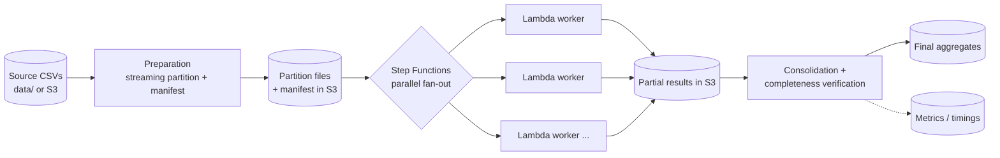

# Architecture

Current architectural understanding for the parallel CNPJ "Estabelecimentos" processing pipeline and its performance experiment. Every element is tagged:

- **[Confirmed]** — agreed with the project owner or established by existing implementation.
- **[Proposed]** — plausible option under consideration; not yet approved or validated.
- **[Open]** — requires clarification, investigation, or a future decision.

Companion context: `../AGENTS.md` (working rules) and `docs/project-overview.md` (goals, requirements, environment).

## High-level data-processing flow

[Proposed] Logical pipeline. Concrete component boundaries and contracts are not yet designed; this diagram only fixes the overall shape.

## Components and responsibilities

| Component | Responsibility | Status |
|---|---|---|
| Source data store | The 10 decompressed Estabelecimentos CSVs (~16.2 GB total). Locally under `data/` (gitignored); on AWS, uploaded to S3. | [Confirmed] |
| Preparation stage | Stream the CSVs, compute record-aligned byte-range units, write base + composed manifests. Implemented: `src/prepare.ts` + `src/core/prep-scan.ts` (13 tests). | [Implemented] |
| Manifest | The single source of truth for coverage: every input record belongs to exactly one unit; consolidation verifies all units completed. | [Implemented] |
| Orchestration | Step Functions state machine `cnpj-pipeline`: Distributed Map with JSON `ItemReader` + `MaxConcurrencyPath` (both validated on Floci), Lambda workers, consolidator task. | [Implemented] |
| Workers | Node.js/TypeScript Lambda; each streams its byte range via Range GetObject, counts dimensions, writes a partial JSON to S3. `src/functions/worker.ts`. | [Implemented] |
| Storage layout (S3) | Single bucket `cnpj-pipeline-<account>`: `raw/`, `manifests/`, `runs/<runId>/partials/`, `runs/<runId>/result.json`. | [Implemented] |
| Consolidation | Merges partials, verifies completeness (units, rows, accounting invariant), writes final JSON. `src/functions/consolidator.ts`. | [Implemented] |
| Measurement harness | `src/experiment.ts` (warm-ups, repetitions, execution-history timings) + `src/report.ts` (speedup/efficiency/throughput tables). | [Implemented] |
| Infrastructure as code | AWS CDK (`lib/pipeline-stack.ts`, `bin/pipeline.ts`); deploys via `cdklocal` locally. IAM includes manifest read + `states:*` self-permissions for real AWS. | [Implemented] |

## Large-input handling

- **Streaming is mandatory** (30 GB RAM vs ~16 GB dataset): both preparation and workers must read bounded windows of data, never whole files. [Confirmed]
- **CSV structure implications** [Confirmed from sample + measurements]: semicolon delimiter, all fields quoted, quoted fields may contain delimiters and line breaks (observed in real data), **no header row**, **ISO-8859-1 encoding** (Latin-1, not UTF-8 — verified by byte analysis). Any partitioner must split on record boundaries (quote-aware), and byte offsets must be Latin-1-exact: the pipeline decodes raw CSVs as latin1 so 1 char = 1 byte.
- **Measured dataset shape** [Confirmed — streaming line counts, 2026-10-18]: part 0 = 31,028,468 records (7.26 GB); parts 1–9 ≈ 4,753,435 records (~1.1 GB) each; total ≈ 73.8M records / 16.2 GB. The release is imbalanced by CNPJ range — partitioning and experiment design must account for part 0 being ~6.5× larger.
- **Partitioning** [Implemented]: record-aligned byte ranges — preparation splits on line starts via `LineCounter` offsets (a unit closes only at a record boundary), so `Range` reads never truncate a record. Base units 16 MB; composed experiment sizes 64/256/1024 MB via `composeUnits`. Part 0's 6.5× imbalance is handled naturally (more units for that file).

## Parallel execution

- **Configurable concurrency** [Confirmed] is the core independent variable. The implemented state machine uses all three validated knobs: `MaxConcurrencyPath: "$.maxConcurrency"`, JSON `ItemReader` for the manifest, and `ItemSelector` to inject run-scoped fields into each unit. `Retry` (2 attempts, backoff 2) on both the worker and consolidator tasks.
- **Fan-out mechanism — Confirmed (owner, 2026-10-18): manifest-driven partitioning.**
  - **Primary (implemented):** Preparation computes record-aligned byte-range units (`src/core/prep-scan.ts`, 13 tests) and writes composed manifests (`units-<n>mb.json`); the Distributed Map fans out one Lambda worker per unit; each worker streams its byte range via `Range: bytes=...` GetObject, parses with the shared `LineCounter`, and writes partial counts. Rationale: explicit control of unit size (the input-size independent variable), auditable completeness, parsing happens in workers (the measured unit), few orchestration items.
  - **Validated fallback (not used): Distributed Map CSV `ItemReader`** — validated on the real sample (headerless CSV, `CSVHeaderLocation: GIVEN`, `CSVDelimiter: SEMICOLON`, batching). Rejected for this project: parsing would run in the SFN engine, unit control is coarser, completeness verification weaker.
- **Saturation study** [Confirmed goal]: sweep concurrency from 1 upward (and vary input size) until wall time stops improving or degrades; measure per-run overhead sources (cold starts, container scheduling, I/O contention, orchestration latency).

## Result consolidation and completeness

- Workers are pure functions of their input partition; partial counts are written to `runs/<runId>/partials/<unitId>.json`, summaries returned through the Map result. [Implemented]
- **Completeness verification** [Implemented]: the consolidator checks `units == expectedUnits`, `sum(rows) == expectedRows`, per-file `lines`/`malformed` match their summaries, and the accounting invariant `lines == parsed + malformed` holds by construction. **Malformed-record policy (owner delegated, decided):** a quote-aware streaming parser counts and skips lines whose field count differs from 30; skipped lines are reported but do not fail the run. Accuracy is explicitly not the project goal — the measured quantity is processing throughput. (Validated against real data: part 9 has 4,753,435 lines, 0 malformed — a full-file scan matches `wc -l` exactly.)
- **Failure handling** [Implemented]: `Retry` (2 attempts, backoff 2) per worker task and on the consolidator; per-unit retries are cheap since units are idempotent byte ranges.

## Local emulation (Floci) vs real AWS

**Floci is the only supported emulator** [Confirmed — user decision; LocalStack excluded]. Two evidence sources: vendor documentation (Sept–Oct 2026) and hands-on probes on this machine (2026-10-18, floci-cli 0.4.0, `floci/floci:latest`; project should pin release 2.3.0 of 2026-10-15).

**Hands-on verified (this machine):**
- S3 create/put/head/list: single-digit ms; path-style endpoint works with SDK v3.
- Step Functions: Distributed Map with CSV `ItemReader` (`CSVHeaderLocation: GIVEN` + 30 `CSVHeaders` + `CSVDelimiter: SEMICOLON`) parsed the real sample correctly (10 rows → 10 items); `ItemBatcher` grouped 3/3/3/1; manifest-driven Distributed and inline Maps with Lambda children both succeeded (10 child executions, concurrency 1 and 5); AWS-parity schema validation rejects a literal `Items` field in JSONPath Maps (`ItemsPath` required).
- Lambda: `nodejs24.x` runtime works (matches the pinned Node 24); cold start ≈ 17 s on first image pull, ≈ 1.3 s for additional container spins, 3–4 ms warm; 48 concurrent invokes succeeded with sublinear total time.
- CloudFormation: stack with bucket + IAM role + Lambda + SFN state machine reached `CREATE_COMPLETE` in ~36 ms and deleted cleanly.
- **AWS CDK: fully working locally** via `cdklocal` (aws-cdk-local v3): `cdklocal synth` → `cdklocal bootstrap --force` (bootstrap IS required) → `cdklocal deploy --require-approval never` deployed a CDK app (S3 bucket, Lambda with real code asset, SFN state machine) in 5.84 s; the deployed function invoked successfully. Requires `AWS_ENDPOINT_URL_S3=http://s3.localhost.floci.io:4566` for asset publishing. **Decision: AWS CDK is confirmed as the IaC tool.**

**Documented limits that shape the experiment (from Floci docs):**
- Lambda Runtime API port range 12000–12499 → **hard cap of 500 concurrent executions** locally; per-region concurrency limit default 1000 (configurable via `FLOCI_SERVICES_LAMBDA_REGION_CONCURRENCY_LIMIT`); warm pool `max(4, cpus)` = 12 here.
- S3 `memory` storage mode has a ~2 GiB cap → **use disk-backed persistent S3 storage** (`FLOCI_STORAGE_SERVICES_S3_MODE=persistent`) for the 16 GB dataset; multipart upload supported.
- Step Functions `Wait`/`Retry` pauses capped at 30 s locally (`max-wait-seconds`); provisioned concurrency unimplemented; large-function cold-start populates can serialize (tunable via `FLOCI_SERVICES_LAMBDA_CODE_VOLUME_POPULATE_CONCURRENCY`).
- `floci-cli` supports `profiles` and `snapshot save/load` for reproducible experiment instances.
- Flakiness observed in persistent mode: `cdklocal deploy` intermittently fails with `ChangeSetNotFoundException` (Floci executes/deletes changesets before CDK polls them); retrying (optionally with `-v`) succeeds. Note for the workflow: redeploys may need 1–2 retries.

**Fidelity limits to respect** [Confirmed expectations]:
- Emulator timings ≠ AWS timings (startup, cold starts, network, orchestration latency). Local and AWS runs are separate measurement regimes; local results are for development, correctness, and *relative* concurrency scaling, not absolute performance claims.
- Service-side quotas differ (500/1000 local caps vs AWS account quotas). Concurrency sweeps must record which limit governed each run, and methodology must warm up functions before timed runs (cold-start regime measured separately).

**Coupling rule** [Confirmed]: application code uses AWS SDK v3 + standard endpoint configuration only; Floci-specific configuration is confined to the operational/experiment layer. Pin the Floci image to a fixed version tag for reproducibility.

**Real AWS** [Confirmed planned]: account exists; credentials setup deferred. The same IaC and code must deploy unmodified; timing comparisons are qualitative (e.g., saturation point, scaling shape), not absolute values.

## Observability

- [Proposed] CloudWatch Logs from workers (emulated locally by Floci), Step Functions execution history (rich event data, including per-branch timing), and S3-level accounting (object counts, sizes).
- [Proposed] Explicit timing instrumentation in the harness: prep time, fan-out time, per-worker durations, consolidation time, total wall time — plus throughput (records/s) and per-run configuration metadata.
- [Open] Whether to use CloudWatch Metrics vs plain files for experiment data.

## Performance measurement approach

- Baseline `T(1)` with concurrency 1; then increasing concurrency levels (set to be defined) and, separately, increasing input sizes.
- Per configuration: N repeated runs (assignment requires repetition; count to be defined), reporting mean/median wall time and throughput.
- Derived metrics: speedup `S(p) = T(1)/T(p)`, parallel efficiency `S(p)/p`.
- Saturation: identify the knee/ceiling, and attribute it (I/O, CPU contention, emulator orchestration, Lambda scheduling, consolidation serialization).
- Local experiments use controlled subsets (one or a few archives); one full 10-archive end-to-end run validates scale and completeness. [Confirmed]

## Technical risks and alternatives

| Risk | Notes |
|---|---|
| Emulator fidelity | S3/SFN in-process engines; timing artifacts; quota differences. Mitigation: validated feature set (2026-10-18 probes); measurements emulator-aware; warm-up before timed runs. |
| Dataset scale on one machine | 16 GB data on 282 GB disk is fine; 30 GB RAM forces streaming. Full local runs may take long; subsets are the experiment workhorse. |
| Malformed records | Policy decided: counted and skipped (accuracy not the goal); quote-aware parser must still be correct about row boundaries or counts become meaningless. |
| Fan-out choice | Confirmed: manifest-driven partitioning; CSV `ItemReader` kept as validated fallback. |
| AWS cost/time of full run | One full run on AWS is planned; budget and time must be validated with the owner before execution. |
| Consolidation bottleneck | Final merge is serial by nature; must be instrumented so it doesn't silently dominate results. |
| Local concurrency ceilings | 500-execution Runtime API cap and 1000 region limit bound the sweep; document the binding limit per run. |
| Alternatives considered and not selected | SQS fan-out, local non-AWS Node baseline, LocalStack. [Confirmed] |

## Open architectural questions

1. Final experiment parameter sets (concurrency levels, partition sizes, repetition counts) — defaults proposed; the harness (`src/experiment.ts`) implements them, pending the real-data sweep.
2. AWS credentials setup timing and full-run budget (account exists; stack IAM is already real-AWS-ready).
